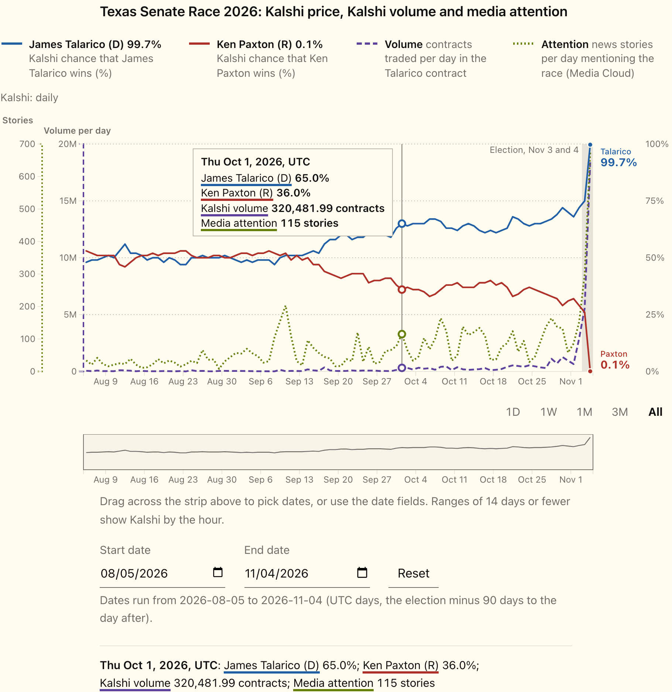

# kalshi-midterm-analysis

An open research dashboard that puts Kalshi prices for the 2026 US midterm races next to media attention for the
same race, on one UTC clock. It asks which moves first, the news or the market.

Live version: planned at alexfisher.co/kalshi-midterm-analysis.
Status: pilot. The pipeline and dashboard run for six races; news counts exist for Texas Senate only. No findings
are reported yet.



## Research questions

1. When news coverage of a Senate race rises, does the Kalshi market for that race change?
2. Does media attention come before trading volume, or after it?

The project reports timing and association, not causation.

Why it matters: prices from prediction markets are quoted in headlines as forecasts. If attention moves trading,
part of a price is the news cycle. If the market moves first, the news is following it. The design is meant as a
framework: people get news from a growing set of places, and any source can be compared to Kalshi markets the same
way. The pilot uses news stories. Each added source gives a wider view of how media attention and prediction
markets relate.

## Definitions

- **Media attention:** how often the race appears in the news each day, counted as stories that mention the
  candidates or the race. In the pilot this is news stories from Media Cloud. Wikipedia pageviews are available as
  a second choice. The full study adds more sources, such as social posts and search interest, and reports each
  one separately.
- **News spike:** a day with at least twice the average story count of the prior seven days.

## Method

The planned design is a spike-day comparison:

1. Find the news spikes for a race.
2. Line up Kalshi volume and price from 3 days before to 3 days after each spike, and average across spikes.
3. Compare that with ordinary days. One chart shows what the market usually does around a news spike.

Election days are excluded from tests. Texas Senate is the exploratory case. The other Senate races are the test,
with the spike rule and race list fixed before they are analyzed. Search queries are frozen after a hand audit of
100 stories per query, with precision reported and a second coder checking agreement.

What is built today: the pipeline computes attention surprise, lag tables, spike and reversion metrics and quality
checks, and writes them to `data/processed/<race>.json`. The dashboard shows the series themselves (price, volume,
attention). The spike-day chart is not on the dashboard yet. Full method notes:
[docs/pipeline-reference.md](docs/pipeline-reference.md#method) and [docs/spec.md](docs/spec.md).

## What the dashboard shows

The page has a US map and, below it, one line chart for the selected race.

**Map.** "Kalshi volume by state and media attention." Each state with a race is shaded by Kalshi contracts traded
over the window, in five bins, with a legend row under the map. States that are not available yet are drawn faded
("coming soon"). The info mark next to the title defines media attention. Click a state to select its race (Texas
only for now).

**Filters** (the sliders icon at the top right of the map header):

| Control | Options |
|---|---|
| State | Texas is active. Other states are greyed out for now. |
| Race type | Senate is active. Governor, House and National are greyed out for now. |
| Map metric | Kalshi trading volume (default) or Attention |
| Polling | All, Few polls (under 10), or Many polls (10 or more) |
| Sources | News (Media Cloud) or Wikipedia. More sources are in development. |

The filter choices are saved in the page URL, so a view can be shared.

**Line chart.** Two price lines, one per major candidate, on a 0 to 100% axis: the Kalshi chance that each wins
(Texas Senate: James Talarico (D) and Ken Paxton (R)). Two more lines have their own axes: Kalshi volume
(contracts traded) and media attention (stories per day, or Wikipedia pageviews). The legend row above the chart
names each line and switches it on or off. Election days (Nov 3 and 4) are shaded.

- **Range buttons:** 1D, 1W, 1M, 3M and All. 1D, 1W and any range of 14 days or fewer show Kalshi by the hour.
- **Date fields and the strip under the chart:** pick any dates from Aug 5 to Nov 4, 2026 (UTC).
- **Reading values:** hover, tap, or use the left and right arrow keys. A tooltip lists the time (UTC), both prices,
  volume and attention. A text line under the chart shows the same on phones.
- **Hourly view:** Kalshi price and volume are hourly. Media attention stays daily at every zoom level, because
  Media Cloud dates have no time of day. It is drawn as a flat step across each day, never as hourly values.
- **Light and dark themes** (sun and moon icon). Keyboard and screen reader friendly.

`--demo` (see below) swaps in synthetic news counts and labels the chart "Demo data".

## Data sources

| Source | What it supplies | Key needed |
|---|---|---|
| [Kalshi public market data API](https://docs.kalshi.com/getting_started/quick_start_market_data) | Hourly and daily price, volume and trade counts for each race's Democratic and Republican contracts, Aug 5 to Nov 4, 2026 | No |
| [Media Cloud](https://www.mediacloud.org/) | Daily story counts: a US national collection (246 sources) and a Texas state and local collection (593 sources) | Free key, only to refresh the data |
| [Wikipedia pageviews](https://pageviews.wmcloud.org/) | Daily pageviews for race and candidate pages | No |

Pilot counts, Texas Senate, Sept 1 to Nov 2: 4,928 national and 3,875 Texas local stories, with no missing days.
The Media Cloud queries are still in draft and the hand audit of precision has not been coded, so treat the news
counts as provisional. Other connectors (Bluesky, X, Guardian, NYT, GDELT) exist in the code; their status is in
[docs/pipeline-reference.md](docs/pipeline-reference.md#data-sources).

The processed data for all six races is committed in `data/processed/`, so the dashboard runs right after a clone
with no keys. Races covered: Texas Senate and Governor, Ohio, North Carolina, Florida and Kentucky Senate.

## Run the dashboard locally

You need:
- **Python 3.11.** Do not use the macOS system Python, which is too old.
- **Node.js 20.19+ or 22.12+** with npm (the dashboard is built with Vite).
- **git.**

You do not need any API keys.

**1. Get the code**

```
git clone https://github.com/afisher3578/kalshi-midterm-analysis.git
cd kalshi-midterm-analysis
```

**2. Set up Python**

```
python3.11 -m venv .venv
source .venv/bin/activate          # Windows: .venv\Scripts\activate
pip install -r requirements.txt
```

**3. Install the web dependencies**

```
cd web
npm ci
cd ..
```

**4. Start the dashboard**

```
python -m raceattn dashboard --race tx-senate-2026
```

The first run builds the page, which takes a minute. Then it prints a URL and opens your browser:
`http://127.0.0.1:4173/?race=tx-senate-2026`. It serves on your machine only. Press Ctrl+C to stop.

Useful options:

| Option | What it does |
|---|---|
| `--no-open` | Do not open a browser |
| `--port 4180` | Use another port (`--port 0` picks a free one) |
| `--demo` | Use synthetic news counts, labeled "Demo data" |
| `--no-build` | Serve the existing `web/dist` without rebuilding |

If something goes wrong:
- **"Node.js and npm are needed"**: install Node (version above), then run the command again.
- **Port already in use**: stop the other server or pass `--port 4180`.
- **Python or SSL errors on install**: you are probably on the system Python. Use 3.11 from python.org or Homebrew.
- **The attention line is off for a race**: only Texas Senate has news counts so far.

More: [docs/pipeline-reference.md](docs/pipeline-reference.md#troubleshooting).

## Refresh the data (optional)

Everything above runs from the committed data. To pull fresh data, copy `.env.example` to `.env` and add a free
Media Cloud key (create an account at https://search.mediacloud.org and copy the key from your profile):

```
cp .env.example .env               # then add MEDIACLOUD_API_KEY=...
python -m raceattn validate --race tx-senate-2026
python -m raceattn run --race tx-senate-2026
```

A run with `--sources` rewrites the race file with only those sources, so use the full list to avoid dropping data.
The commands, flags, request pacing and cache behavior are in
[docs/pipeline-reference.md](docs/pipeline-reference.md#run-it).

## How it works

```
config/races/<race>.yaml      one file per race: Kalshi market, window, Wikipedia pages, names, news query
config/queries/               Media Cloud queries and collections (Texas Senate so far)
        |
connectors (one per source)   raw responses cached in data/raw/ (git-ignored)
        |
one UTC clock                 hourly and daily buckets; missing stays missing, nothing is interpolated
        |
metrics                       quality checks, surprise, lag tables, spike and reversion
        |
data/processed/<race>.json    committed; index.json has one entry per race
        |
dashboard (web/)              served locally by `python -m raceattn dashboard`
```

Layout: `raceattn/` (Python package), `web/` (Vite, TypeScript, D3, Observable Plot), `config/`, `data/processed/`,
`docs/` (spec, source notes, history, screenshots), `tests/`, `scripts/`. A fuller map is in
[docs/pipeline-reference.md](docs/pipeline-reference.md#outputs-and-layout).

## Tests

```
pip install -r requirements-dev.txt
pytest -q                                   # offline, uses recorded fixtures
cd web && npm run check && npm test && cd ..
python scripts/check_secrets.py
```

`npm run verify` runs the browser and accessibility checks and needs Chromium. Setup and the contrast check are in
[docs/pipeline-reference.md](docs/pipeline-reference.md#tests-and-status).

## Limitations

- Counts are a proxy for attention, not a measure of who saw what. A story is not a reader.
- News counts come from Media Cloud's outlets only, in English, from US sources. Paywalled content is thin.
- Only Texas Senate has news counts so far. The Media Cloud queries are draft and their precision is not yet measured.
- The study reports timing and association. Nothing here shows that attention causes trading or price moves.
- After the election, prices settle near 0% and 100%. The chart shades Nov 3 and 4, and the planned tests exclude them.
- No story text, post text or user data is published. The repo holds counts and metrics.

## Data terms

- Kalshi: public, unauthenticated, read-only market data. Kalshi's terms on redistributing derived aggregates have not
  been reviewed yet ([docs/sources/kalshi.md](docs/sources/kalshi.md)).
- Media Cloud: aggregated counts may be distributed under its terms of use, with attribution recommended.
- Wikipedia pageviews: public data under the Wikimedia Terms of Use.
- Map shapes: us-atlas 3.0.1 from US Census Bureau boundaries, ISC license, notice in `web/src/geo/LICENSE-us-atlas`.
- Open questions and status for every source: [docs/licensing.md](docs/licensing.md).

## License

No license has been chosen yet. Until one is added, the code and data are all rights reserved.

## Author

Alex Fisher, independent media researcher, Brooklyn, NY. [alexfisher.co](https://alexfisher.co)

Suggested citation, until a release exists: Fisher, A. (2026). *kalshi-midterm-analysis* [software and data]. GitHub.
https://github.com/afisher3578/kalshi-midterm-analysis
