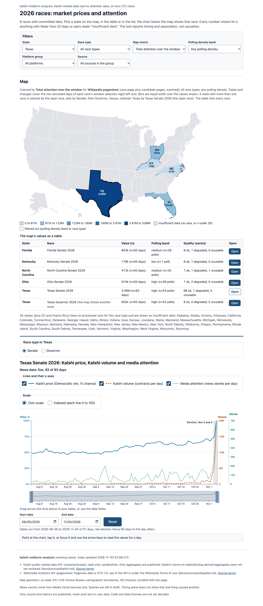

# kalshi-midterm-analysis

## What this is

This tool compares Kalshi prices for 2026 US midterm races with news and platform attention to the same race.

The question: does attention change how much a race is traded, and does it change where the price goes? Or do
listed events (debates, filings, primaries, polls) do that? The tool reports timing and association, not causation.
It only reads public or keyed APIs. Nothing is posted or traded from here.

The Python package is `raceattn` (`python -m raceattn`). The web front end is in `web/`. Milestone history is in
[docs/history.md](docs/history.md); the full design is in [docs/spec.md](docs/spec.md).

## How it works

```
config/races/<race>.yaml        one file per race: Kalshi market, window, Wikipedia pages, names, news query
config/queries/<race>.mediacloud.yaml   Media Cloud queries and collections (Texas Senate only so far)
        |
        v
connectors (one per source)     kalshi, kalshi_trades, wikipedia, bluesky, x, news_mediacloud, news_guardian,
        |                       news_nyt, news_manual, gdelt; raw responses cached in data/raw/
        v
one UTC clock                   hourly and daily buckets on the race window; missing stays missing
        |
        v
metrics                         quality checks, surprise, lag tables, event and spike metrics
        |
        v
data/processed/<race>.json      plus index.json (one entry per race)
        |
        v
dashboard (web/)                served locally by `python -m raceattn dashboard`
```

Connectors render every request from the race config and hard-code nothing. A connector whose key or file is
missing is skipped, and the reason is written to the output.

## Quick start

Requirements:
- Python 3.11. There is no pyproject.toml and `requirements.txt` does not pin a Python version; 3.11 is what this was
  built and tested with. Do not use the macOS system Python: it is too old (and has no CA certificates).
- Node.js 20.19+ or 22.12+ and npm, for the dashboard build (Vite 8 requires one of those). Tested with Node 22.23.2
  and npm 10.9.8, and with Node 26.7.0 and npm 11.19.0.

```
git clone https://github.com/afisher3578/kalshi-midterm-analysis.git
cd kalshi-midterm-analysis
python3.11 -m venv .venv
source .venv/bin/activate
pip install -r requirements.txt          # requirements-dev.txt adds pytest
cp .env.example .env                     # then fill in any keys you have (see below)
cd web && npm ci && cd ..
python -m raceattn dashboard --race tx-senate-2026
```

The processed outputs for six races are committed, so the dashboard works right after a clone with no keys.
Optional: `ln -sf ../../scripts/hooks/pre-commit .git/hooks/pre-commit` runs the secrets check on every commit.

## API keys

No key is required. Kalshi, Wikipedia pageviews, Bluesky (unauthenticated), the manual news CSV and GDELT run
without one. Put keys in `.env` at the repo root (git-ignored). The CLI loads it at startup, never overrides a
variable already set in your shell, and never prints values. Exporting them in your shell works too.

| Key | Source | Where to get it | Cost | Notes |
|---|---|---|---|---|
| `MEDIACLOUD_API_KEY` | Media Cloud (`news_mediacloud`) | Free account at https://search.mediacloud.org, key on your profile page | Free | Quota 4000 requests a week; some endpoints 2 a minute. Requests are paced 30 s apart |
| `X_BEARER_TOKEN` | X post counts (`x`) | X developer portal, https://developer.x.com/en/portal/dashboard | Pay per use, about $0.010 per counts/all request (unverified against a bill) | Runs only with `--yes` or `--max-spend USD`; prints its estimate first |
| `GUARDIAN_API_KEY` | Guardian (`news_guardian`) | https://open-platform.theguardian.com/access/ | Free developer key, non-commercial | 1 call a second, 500 a day; one call per day of the window |
| `NYT_API_KEY` | New York Times (`news_nyt`) | https://developer.nytimes.com/get-started | Not recorded in the docs | 500 requests a day, 5 a minute; 12 s between calls |
| `BSKY_HANDLE`, `BSKY_APP_PASSWORD` | Bluesky (`bluesky`) | Bluesky app: Settings, Privacy and security, App passwords | Free | Optional. Tries cursor paging; this mode is unverified |
| `REDDIT_CLIENT_ID`, `REDDIT_CLIENT_SECRET` | Reddit | https://www.reddit.com/prefs/apps | | Connector not built; the keys are not read |
| `YOUTUBE_API_KEY` | YouTube | https://console.cloud.google.com/apis/credentials | | Connector not built; the key is not read |

Media Cloud, step by step:
1. Create a free account at https://search.mediacloud.org and sign in.
2. Copy the API key from your profile page.
3. Put it in `.env`: `MEDIACLOUD_API_KEY=<your key>`.
4. Check it: `python -m raceattn mediacloud collections --state TX`. This lists collections whose name matches Texas.
   The Texas query file already has both collections: `national` (United States - National, id 34412234) and
   `texas_local` (Texas, United States - State & Local, id 38381323). A collection with a null id is skipped and
   reported as not configured, never counted as zero.

More detail: [docs/sources/mediacloud.md](docs/sources/mediacloud.md). Other sources: `docs/sources/*.md`.

## Run it

Activate the venv first (`source .venv/bin/activate`). Every command below runs from the repo root.

Pipeline for one race (default sources from `default_sources` in `config/project.yaml`):

```
python -m raceattn validate --race tx-senate-2026        # check the race config and the Media Cloud query file
python -m raceattn run --race tx-senate-2026             # all default sources; keyed ones without a key are skipped
python -m raceattn run --race tx-senate-2026 --sources kalshi,wikipedia   # quick test; replaces the race JSON
python -m raceattn run --all                             # every confirmed config in config/races/
```

Any run with `--sources` rewrites `data/processed/<race>.json` with only the sources of that run. There is no
merge (this is still true in `raceattn/pipeline.py`). So the `--sources kalshi,wikipedia` line above drops
Bluesky, Kalshi trades and any other source from the dashboard until you run the full list again. To restore the
race, run it without `--sources`, or with every source you want to keep.

`--race` takes a race id (`config/races/<id>.yaml`) or a path to a yaml file. Other `run` options: `--refresh`,
`--yes`, `--max-spend USD`, `--raw-dir`, `--out-dir`, `--mediacloud-pace SECONDS`. The raw cache (`data/raw/`) is
not in git, so a fresh clone fetches everything once. The Texas Bluesky walk is about 2,000 requests and 22
minutes the first time; later runs read the cache.

Display window. A race config can set `display_window: {start, end}` (UTC dates, inclusive; default election
day minus 90 days to the day after election day). It has to contain `window`. When the config sets it, `run`
also writes `series.display_daily`: one row per date (Aug 5 to Nov 4 for the current races) with the Kalshi
close and volume, the Wikipedia total and, for Texas, the Media Cloud count per query and collection, plus
coverage and missing days per column. It is for charts only. The metrics, quality and `series.daily` still use
`window`. Days inside `window` reuse the analysis values. Days outside it are read from any cached window in
`data/raw` first, and only dates no cache covers are pulled. Pass `--no-display` to skip it, or `--display` to
build it from the default window when the config does not set one.

Hourly display series. With `series.display_daily`, `run` also writes `series.display_hourly`: the hourly Kalshi
close and volume (same columns as `series.hourly`, `ts_utc` is the candle end) on a full hourly grid from display
start 00:00 UTC to the market's last candle. Inside `window` the rows are the `series.hourly` rows; outside it they
come from the cache the same way as the daily block. An hour with no candle gets the previous close and volume 0,
and those hours are listed in `filled_hours`. An hour whose candle has a null price (the analysis pull had no
earlier close) also gets the previous close but keeps its volume, listed in `forward_filled_null_price`; `series.hourly`
keeps the null. Only leading hours with no earlier close stay null (`null_price_hours`). A `reconciliation` block checks every display date against
`series.display_daily` (hourly volume sum and last hourly close) and lists any mismatch. It is for charts only; the
metrics never read it. `series.granularity` says which sources are hourly: Kalshi has hourly and daily values,
while Wikipedia and Media Cloud are daily only (Media Cloud publish dates have no time of day). To add both blocks
to existing processed files without a full run, use `python -m raceattn display-hourly --all` (or `--race ID`,
plus `--refresh`, `--raw-dir`, `--out-dir`). It reads `series.hourly` from each file and the Kalshi cache and
leaves every other key as it is.

Republican contract and candidates. Next to the followed Democratic contract, `run` also adds the Republican
contract of the same Kalshi event, read from the event's markets list (the market whose subtitle names the
Republican party, not a ticker pattern). Its hourly candles for the display window use the same chunks, cache and
pacing. `series.display_hourly` gets two columns at the end of every row, `kalshi_r/price_close` and
`kalshi_r/volume`, on the existing grid (no rows added, forward fill and volume 0 for hours with no R candle,
leading hours with no R close stay null). `series.display_daily` gets `kalshi_r_price_close` and `kalshi_r_volume`
with the same daily definition as the Democratic columns. `series.display_hourly.opposing` records the ticker,
candidate name, source, requests, leading null hours, a reconciliation of hourly R against daily R and a sum check
(D close plus R close, flagged when the mean is more than 0.05 away from 1). A top-level `candidates` block lists the
D and R candidates (names from the race config, matched to the Kalshi markets and checked against the Wikipedia
infobox nominees) and any other market of the event under `left_out`. The chart still uses the Democratic volume, and
the metrics never read any of this. To add it to existing processed files, use `python -m raceattn display-opposing
--all` (or `--race ID`, plus `--refresh`, `--raw-dir`, `--out-dir`); a second run reads everything from the cache.

Media Cloud pull for Texas, once the key is in `.env`:

```
python -m raceattn run --race tx-senate-2026 --sources kalshi,kalshi_trades,wikipedia,bluesky,news_mediacloud
```

Plain `run --race tx-senate-2026` also includes Media Cloud, since it is in the default list. Use the full source
list as above. Do not run `--sources news_mediacloud` alone: for the reason above, the Kalshi, Wikipedia and
Bluesky data would drop out of the dashboard. The other sources come from the cache. The Texas query file makes 16
Media Cloud requests per run (8 queries x 2 collections) at 30 s apart, so about 8 minutes. Later runs read the
cache.

Other commands:

```
python -m raceattn events --race tx-senate-2026          # draft config/events/<race>.csv, every row needs_review
python -m raceattn discover --office senate --state TX   # draft configs in config/races/drafts/
python -m raceattn mediacloud audit --race tx-senate-2026 --phase tuning --n 100 --seed 1
python -m raceattn mediacloud precision data/local/mediacloud/audit/tx-senate-2026/tuning.csv
python -m raceattn mediacloud agreement coder_a.csv coder_b.csv
python -m raceattn publish                               # licensing and funding-flag check; sends nothing
```

Event rows and discover drafts are trusted only after a human reviews them (`status: confirmed`).

### Dashboard

```
python -m raceattn dashboard --race tx-senate-2026
python -m raceattn dashboard --race tx-senate-2026 --demo
```

Flags: `--port N` (default 4173; `0` picks a free port), `--no-open` (do not open a browser), `--no-build` (serve
`web/dist` as it is, skip the Node check and the build), `--demo`. It builds `web/` when `web/dist` is missing or
older than its inputs, then serves on 127.0.0.1 only and prints the URL:
`http://127.0.0.1:4173/?race=tx-senate-2026`. `data/processed` is read on every request, so a new
pipeline run shows without a rebuild. Ctrl+C stops it.

The page is the US map and, directly below it, one line chart for the selected race (Texas Senate by default).
The chart draws the Kalshi price of the Democratic-win contract (percent chance, left axis), Kalshi volume
(contracts per day, right axis) and media attention (Media Cloud national stories per day for the `race_either`
query, second right axis) from `series.display_daily`. Checkboxes switch each line and its axis on or off (one always
stays on), "Indexed" puts every line on one 0 to 100 scale, and the date fields or the strip under the chart narrow
the dates within the 90 days before the election. Point at, tap or arrow-key through the chart to read a day's
values. Only Texas Senate has news counts so far; for the other races the attention line is off. `--demo` swaps in
synthetic news counts and labels the chart "Demo data". The race detail views (charts, lag tables, the News view)
are hidden for now and come back with `SHOW_DETAILS = true` in `web/src/config.ts`.



## Data sources

Status as of the committed outputs and `docs/sources/*.md`.

| Source | Id | Key | Status |
|---|---|---|---|
| Kalshi candlesticks | `kalshi` | none | Works. Ran live for six races |
| Kalshi trades | `kalshi_trades` | none | Works. Ran live; trade count and small-trade share |
| Wikipedia pageviews | `wikipedia` | none | Works. Ran live for six races |
| Bluesky search | `bluesky` | optional | Works, degraded: unauthenticated paging only; days that hit the page cap are lower bounds and marked degraded. Authenticated mode unverified |
| Media Cloud | `news_mediacloud` | needs key | Works. Ran live for Texas Senate on 2026-11-12, two collections (national, texas_local); queries are still draft, precision not coded yet ([docs/mc3-notes.md](docs/mc3-notes.md)) |
| Guardian | `news_guardian` | needs key | Not yet run. Built against documented shapes; licensing question open (24-hour rule) |
| New York Times | `news_nyt` | needs key | Not yet run. Built against documented shapes |
| X post counts | `x` | needs key, paid | Not yet run. Built against documented shapes; terms read against publishing counts |
| Manual news CSV | `news_manual` | none | Needs a file at `data/raw/news_manual/<race_id>.csv` (`date,count`) |
| GDELT DOC | `gdelt` | none | Unusable in the pilot (gaps, near-zero days). Optional, not in the default list |
| Reddit, YouTube, Google Trends import, Polymarket | | | Not built (M4 in the spec) |
| TikTok, Discord, Telegram, Threads, Substack | | | Out of scope |

One known unusable series: `kalshi/volume` for `nc-senate-2026` (near-zero days over 10% of the window; see
[docs/m3-notes.md](docs/m3-notes.md)).

## Method

- Attention measure: counts per UTC time bucket. Wikipedia pageviews per day (user agents only), Bluesky and X posts
  per hour, news stories or articles per day. Outcomes: Kalshi contracts traded (`kalshi/volume`), trade count, and
  the daily close of the followed market (the Democratic party contract).
- Surprise: `ln((x_t + 1) / (mean of the previous 7 same-slot values + 1))`. Same slot is the previous 7 days for
  daily series and the same hour on the previous 7 days for hourly series. Null if x_t or any of the 7 is missing.
- Excluded days (election night for Texas, `exclude_days` in the race config) are masked after the surprise is
  computed, on both sides.
- Lag tables: Spearman rho (average ranks for ties) of attention surprise against volume surprise, absolute price
  change and signed price change, at lags -2 to +2 days (and -3 to +3 hours for X and Bluesky). Lag > 0 means the
  outcome comes after the attention. Cells with fewer than 20 pairs are blank; n is always shown. Noise band
  2/sqrt(n); daily series are autocorrelated, so the band is generous.
- Events: only rows with status `confirmed` in `config/events/<race>.csv` count. Event window: days -2 to +2. Spike:
  attention surprise >= 1.0 (about 2.7 times the trailing mean). Excess attention: a spike with no confirmed event
  within 2 days. Reversion: after a spike-day price move of at least 1 cent, did at least half of it reverse within
  3 days. Settings under `events` in `config/project.yaml`.
- Media Cloud search criteria: [docs/mediacloud-search-criteria.md](docs/mediacloud-search-criteria.md). English
  online news stories per UTC day in fixed collections (US national, and Texas state and local once its id is
  found), run separately. Race-context queries per candidate are the main series; any-mention queries are a
  sensitivity check. Raw count, normalized ratio and the collection's total count are all stored.
- Audit and reliability: 100 random stories per core query and collection, in a tuning phase (Aug 1 to Aug 24)
  and an analysis phase (Sept 1 to Nov 2), coded by hand. Precision = yes / (yes + no), Wilson 95% interval,
  target 0.90. A second coder's file gives simple agreement and Krippendorff's alpha: target 0.80, drop a variable
  below 0.70.
- Quality gate (`raceattn/metrics/quality.py`, on daily buckets): near zero is a day under 5% of the series median
  next to a normal day. `unusable`: coverage under 70%, no data, or near-zero days over 10% of the window.
  `degraded`: coverage under 95%, any near-zero stretch, or a gap of 3 days or more. Otherwise `ok`. Kalshi price
  skips the near-zero check (a low price is a real price). Media Cloud counts need a near-zero stretch of 2 or more
  days; the derived Media Cloud shares skip the near-zero check. Metrics skip `unusable` series and say why.
  Nothing is interpolated.

## Outputs and layout

- `data/raw/<source>/<race>/...` (git-ignored): raw responses with endpoint, params, fetch time and status. No keys.
- `data/processed/<race>.json` (committed): config summary, sources run and skipped with reasons, every rendered
  query and its hash, hourly and daily series, quality per series, lag tables and event metrics.
- `data/processed/index.json` (committed): one entry per race with the map's metrics.
- `data/local/` (git-ignored): Media Cloud audit samples with titles and URLs. Never published.

```
config/races/          one yaml per confirmed race; drafts/ holds discover output
config/queries/        Media Cloud query files
config/events/         event drafts per race and generator metadata
config/project.yaml    default sources, connector settings, race overrides, licensing and funding flags
raceattn/              cli.py pipeline.py dashboard.py discover.py events.py mediacloud.py mcqueries.py ...
raceattn/connectors/   base.py kalshi.py wikipedia.py bluesky.py x.py news.py
raceattn/metrics/      surprise.py lags.py quality.py events.py reliability.py
web/                   dashboard (Vite, TypeScript, D3, Observable Plot); scripts/ holds the verify scripts
data/processed/        committed outputs
docs/                  spec, milestone notes, history, sources/, licensing, search criteria, screenshots
tests/                 pytest suite; fixtures/raw/ holds recorded responses
scripts/               check_secrets.py, hooks/pre-commit, fixture recorders
```

## Limitations and sources

- Counts are a proxy for attention, not a measure of who saw what. A story is not a reader.
- Each source covers only what it indexes: Media Cloud's outlet list is the frame, paywalled content is thin,
  Bluesky counts are lower bounds on capped days, and GDELT has gaps.
- Association and timing only. Nothing here shows that attention causes trading or price moves.
- No story text, post text, usernames or handles are published. Audit samples stay in `data/local/`, which is
  git-ignored. Outputs hold counts and metrics.
- Platform terms and licensing for publishing counts are still open: [docs/licensing.md](docs/licensing.md).
  `licensing_confirmed` is false in `config/project.yaml`, and `publish` exits 1 while that applies.
- The Kalshi grant funding disclosure is off: `funding_disclosure_enabled: false` in `config/project.yaml`, and
  `SHOW_FUNDING_DISCLOSURE` in `web/src/config.ts` (on only with `VITE_FUNDING_DISCLOSURE=on npm run build`).
- The repo is private. No license has been chosen yet.
- News counts on the dashboard come from Media Cloud sources only, and the Media Cloud queries are still draft.
- Kalshi public market data API: unauthenticated, read-only candlesticks. Only aggregates are published. Kalshi's
  terms on redistributing derived aggregates were not yet reviewed ([docs/sources/kalshi.md](docs/sources/kalshi.md)).
  [Source terms](https://docs.kalshi.com/getting_started/quick_start_market_data).
- Wikimedia Analytics API (pageviews): pageview data is CC0 1.0; use of the API is under the Wikimedia Terms of Use
  ([docs/sources/wikipedia.md](docs/sources/wikipedia.md)).
  [Source terms](https://doc.wikimedia.org/generated-data-platform/aqs/analytics-api/documentation/access-policy.html).
- Map geometry: us-atlas 3.0.1, US Census Bureau cartographic boundaries, ISC license, bundled with the page; license
  text in `web/src/geo/LICENSE-us-atlas`, shipped as `web/dist/LICENSE-us-atlas`.

## Troubleshooting

- Missing key: `run` prints `== news_mediacloud: skipped (missing key: set MEDIACLOUD_API_KEY (see .env.example))`
  and a hint about `.env`, records the reason under `skipped`, and exits 0. `mediacloud collections` and
  `mediacloud audit` print an error and exit 2.
- Port in use: the dashboard prints that port 4173 on 127.0.0.1 is already in use and exits 2. Stop the other
  server, or use `--port 4180` or `--port 0` (a free port).
- Node missing: the dashboard prints "Node.js and npm are needed to build the dashboard" and exits 2. If `web/dist`
  is already built, `--no-build` skips the Node check. A fresh clone has no `web/dist`, so it needs Node once.
- Unknown race: the dashboard lists the valid ids from `data/processed/index.json` and exits 2.
- Stale data: responses are cached in `data/raw/`. `--refresh` re-fetches; it exists on `run`, `events`,
  `discover`, `mediacloud collections` and `mediacloud audit`. A cached paid read (X) is never re-pulled.
- Media Cloud HTTP 401, 403 or 429: the run stops at once with the status. Check the key, or wait for the quota.

## Tests and status

```
pip install -r requirements-dev.txt
pytest -q                                   # offline: recorded fixtures, network blocked
pytest -q --live                            # also live smoke tests; keyed ones skip without a key
cd web && npm run check && npm test && cd ..
cd web && npm run build && npm run verify && cd ..
python scripts/check_secrets.py
```

`npm run verify` needs a built `web/dist` and a Chromium for Playwright. It first runs `npm run contrast`, then starts
the dashboard server itself (real and `--demo`) and runs the render, theme, news view and axe checks (light and dark).

`npm run contrast` (web/scripts/contrast.mjs) checks the WCAG contrast of the color tokens in `web/src/style.css` in
both themes and fails on text under 4.5:1 or a chart line under 3:1. Tokens and results: [docs/style-contrast.md](docs/style-contrast.md).

`npm ci` does not download Playwright's browser. On a fresh clone, verify fails with
`Executable doesn't exist ... chromium_headless_shell`. Fix it one of two ways:
- Run `cd web && npx playwright install chromium && cd ..` once.
- Or set `CHROME_PATH` to an installed Chromium or Chrome binary, for example
  `CHROME_PATH=<path to chrome> npm run verify`. This was tested with a Chrome for Testing binary.

Verify rewrites the PNGs in `docs/screenshots/`. Run `git status` afterwards and decide whether to keep or
restore them (`git checkout -- docs/screenshots`).

Status: the pipeline and dashboard work for six races (Texas Senate and Governor, Ohio, North Carolina, Florida,
Kentucky Senate) with Kalshi, Wikipedia and, for five of them, Bluesky. Media Cloud ran live for Texas Senate on 2026-11-12 (MC3,
[docs/mc3-notes.md](docs/mc3-notes.md)); its queries stay draft until the tuning audit is coded. No other keyed
source has run live. History: [docs/history.md](docs/history.md).
